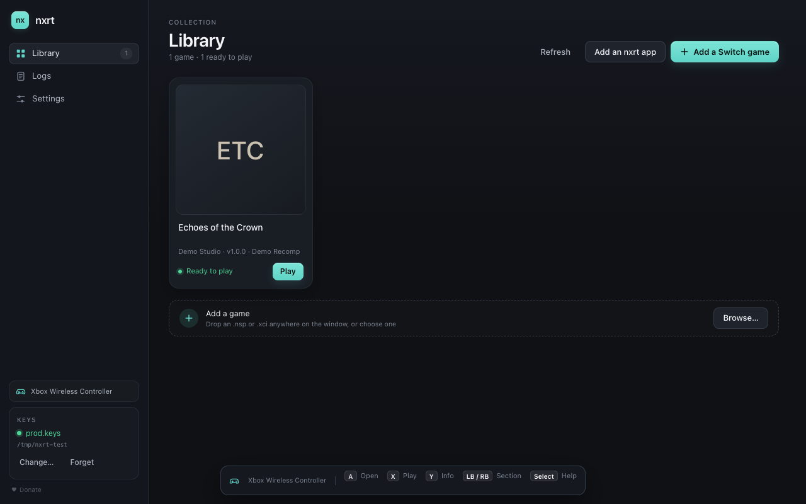
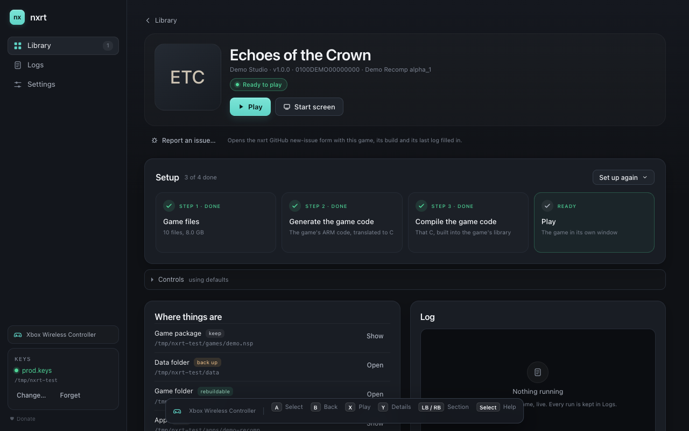
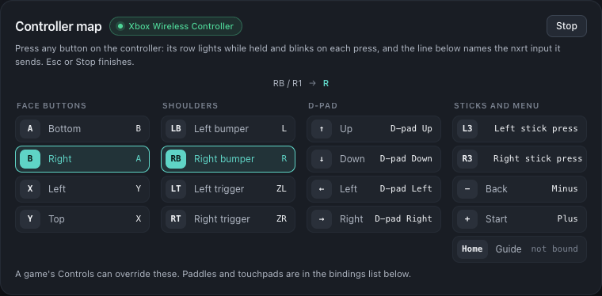

# nxrt-frontend

[](https://github.com/fedebuonco/nxrt-frontend/actions/workflows/ci.yml)

One small manager for Switch games recompiled with [nxrt](https://github.com/fedebuonco/nxrt): your library, each
game's files and game code, and Play.

> **Independent project.** Not affiliated with Nintendo. No games, ROMs, keys or game assets are included.



## What it does

- **One library.** Your games with their covers, versions and readiness, ready to Play.
- **The steps, in one place.** Set up the game files, generate the game code, compile it, then play — with the log
  beside it.
- **Controller-first.** Menus, hints and a controller map that lights each button; bind once globally, override per
  game.
- **Logs that help.** Every run is kept; a game's **Report an issue…** opens a prefilled nxrt issue with the game's
  ids and versions and your macOS version: no paths, no log (attach one yourself if you like).
- **Batteries included.** The nxrt source is built into the app, so creating a recomp needs no checkout.
- **Two backends, one library.** A game runs on nxrt (its recomp) or on [nxnative](https://github.com/seedds/nxnative)
  (the game's own code on this Mac, built from its NSPs); the game page's **Runs with nxrt | nxnative** switch picks, per
  game, and a game can keep both.





_Screenshots of a demo library (a made-up game, the one the tests use). With your own games, the library shows each
game's cover read from your package._

## Build

macOS 11+ (Apple silicon for the bundled build), **Rust 1.90+ via rustup**, **Node 20.19+**, the Xcode command-line
tools, and the `nxrt` submodule.

```sh
git clone --recursive git@github.com:fedebuonco/nxrt-frontend.git
cd nxrt-frontend
npm install
npm run dev       # Vite + Tauri, with hot reload
npm run build     # stages nxrt, builds the window, makes the app
npm run dmg       # packages the app into dist/nxrt-<version>-<arch>.dmg
```

The app bundle lands in `src-tauri/target/release/bundle/macos/`, the DMG in `dist/`. Ready-made DMGs (Apple silicon,
ad-hoc signed, not notarized: right-click → Open the first time) are on the
[Releases](https://github.com/fedebuonco/nxrt-frontend/releases) page.

## Not affiliated with Nintendo

nxrt and nxrt-frontend are independent, fan-made projects. They are not affiliated with, endorsed by, or sponsored by
Nintendo. **We do not provide or distribute games, ROMs, keys, firmware, or any game assets.** You need your own
legally owned copies; the manager reads them in place and never ships them. Screenshots show a personal library for
context only.

## Thanks

This stands on a lot of shoulders.

- **The recompilation community:** N64Recomp, Zelda64Recomp, Majora's Mask, Ship of Harkinian, the Super Mario 64 and
  zeldaret decompilations, and every team that shared a decomp, a recomp, a tool or a write-up.
- **The ports nxrt supports:** LASRecomp (Peiikai), SkyRecomp (Apolinario-coder), EoWRecomp (Nycolazs and contributors).
- **The emulators that paved the road:** Dolphin, Citra, Ryujinx, and the wider emulator community whose code and
  documentation taught us how these systems work.
- **The third-party work in nxrt:** Dear ImGui (Omar Cornut), SMAA, xxHash (Yann Collet), the ReShade headers, the
  Baloo 2 font, SDL3, FFmpeg, Clang/LLVM, zig, and the Python capstone/lz4/unicorn tooling.
- **The window:** Tauri, Vite, the Rust crates (serde, sdl3-sys, tracing, rfd, base64, toml, dirs), Prettier and ESLint.
- **And everyone who tested, documented, and filed an issue.**

## Tests

`cargo test --manifest-path src-tauri/Cargo.toml` (backend), `npm test` (window units), `npm run test:e2e` (the UI with a mocked Tauri).
See [docs/TESTING.md](docs/TESTING.md).

## Docs

- [Using nxrt-frontend](docs/USAGE.md) — adding games, controller settings, updates, logs, the CLI.
- [Architecture](docs/ARCHITECTURE.md) — how the app is put together and what comes next.
- [Logging](docs/LOGGING.md) — the manager's and nxrt's logs.

## License

Public domain ([Unlicense](LICENSE)), like nxrt. The components the app includes keep their own licenses: see
[THIRD_PARTY.md](THIRD_PARTY.md).

nxrt-frontend is not affiliated with Nintendo. Nintendo Switch is a trademark of Nintendo.
